# Лабораторная работа №2. Простой сайт на Django

## Цель работы

Получить навыки создания веб-приложений средствами Django, работы с моделями, представлениями, шаблонами, формами и PostgreSQL.

## Практическое задание 2.1

Был создан отдельный Django-проект об автовладельцах. Реализованы модели пользователя, водительского удостоверения, автомобиля и владения автомобилем. Модели зарегистрированы в Django Admin, созданы и применены миграции.

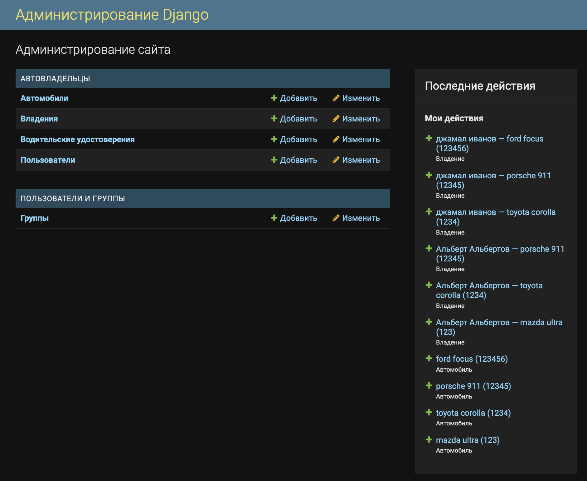

Также реализована страница, отображающая информацию о владельце по его идентификатору.

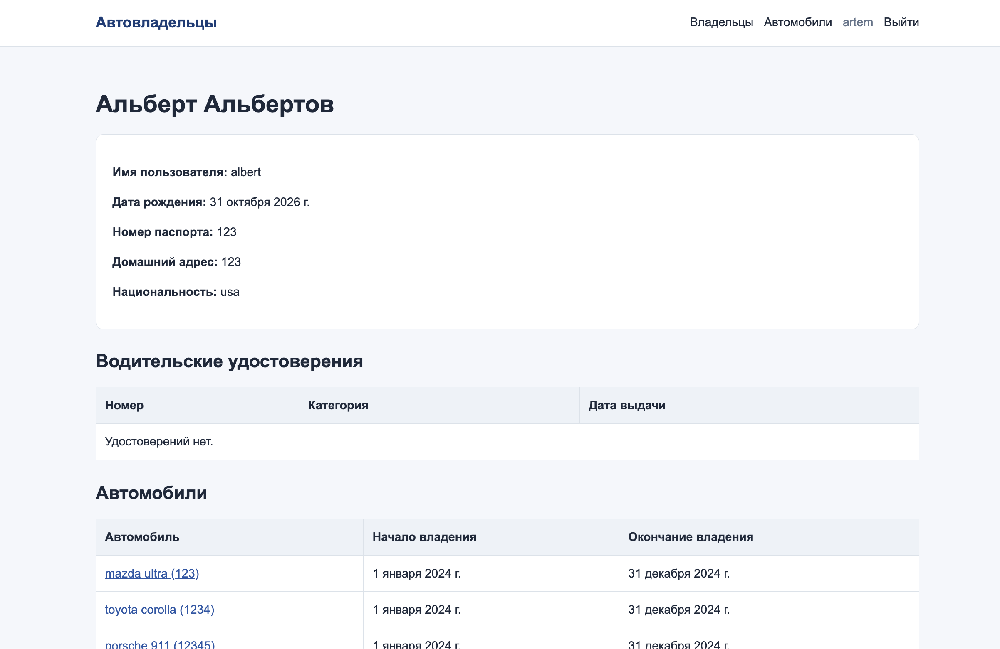

## Практическое задание 2.2

Связь владельцев и автомобилей реализована как «многие ко многим» через промежуточную модель владения с датами начала и окончания.

Список владельцев реализован функциональным представлением. Список автомобилей, просмотр автомобиля по идентификатору, создание, изменение и удаление реализованы представлениями на основе классов.

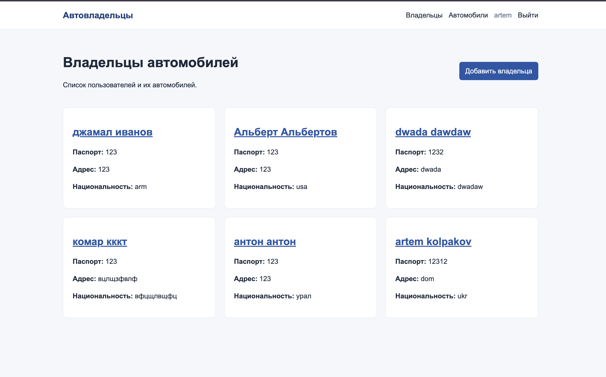
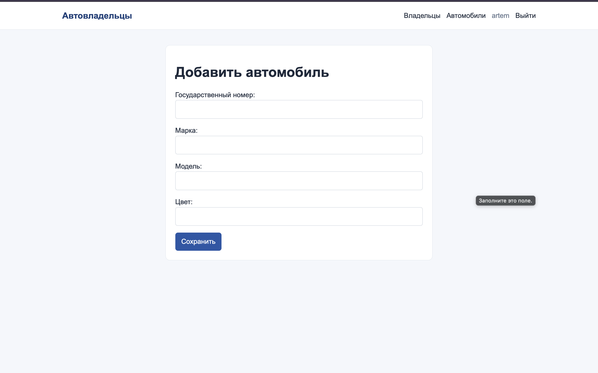

## Практическое задание 2.3

Модель владельца была заменена расширенной моделью пользователя. К стандартным полям добавлены дата рождения, номер паспорта, домашний адрес и национальность. Новые поля доступны в Django Admin и в форме регистрации.

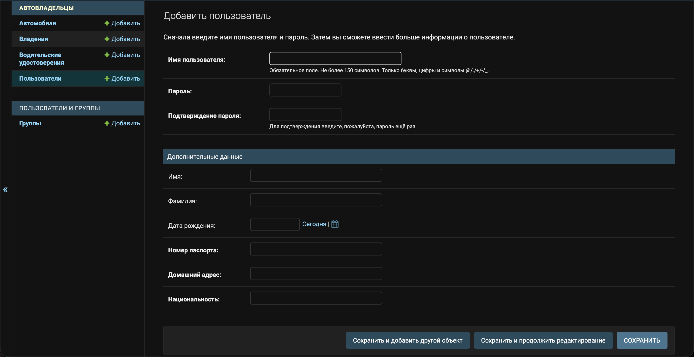

## Индивидуальный вариант

Порядковый номер в журнале — 16, поэтому выбран вариант 4: «Список туров туристической фирмы».

Сайт хранит информацию о странах, турагентствах, названиях и описаниях туров, периодах проведения и условиях оплаты.

## Модель данных

В проекте используются следующие модели:

| Модель         | Назначение                                 |
| -------------- | ------------------------------------------ |
| `Country`      | Страна проведения тура                     |
| `TravelAgency` | Турагентство                               |
| `Tour`         | Информация о туре и периоде его проведения |
| `Reservation`  | Бронирование тура пользователем            |
| `Review`       | Отзыв, даты поездки и рейтинг от 1 до 10   |

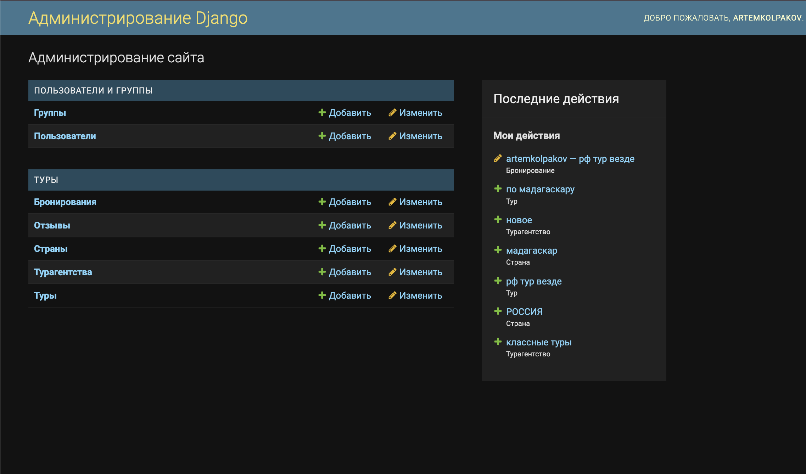

## Клиентские интерфейсы и логика работы

### Регистрация пользователей

Пользователь может зарегистрироваться и войти в систему через клиентский интерфейс.

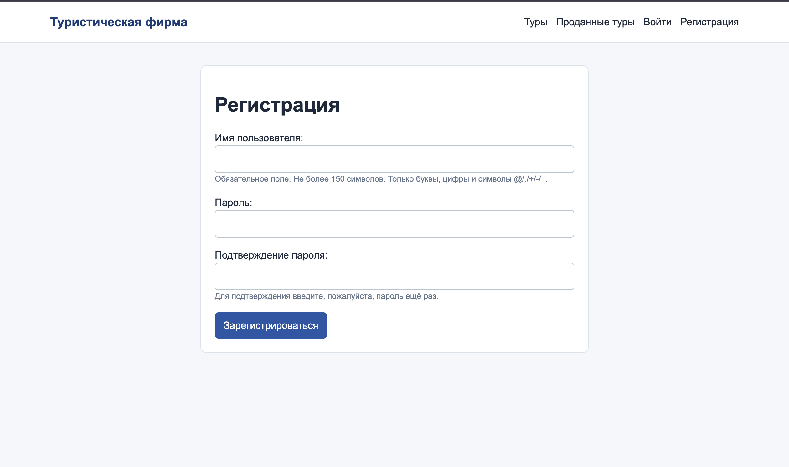

### Просмотр и бронирование туров

На главной странице доступны просмотр, поиск, фильтрация по стране и пагинация туров. Авторизованный пользователь может забронировать тур, а затем изменить или удалить своё бронирование.

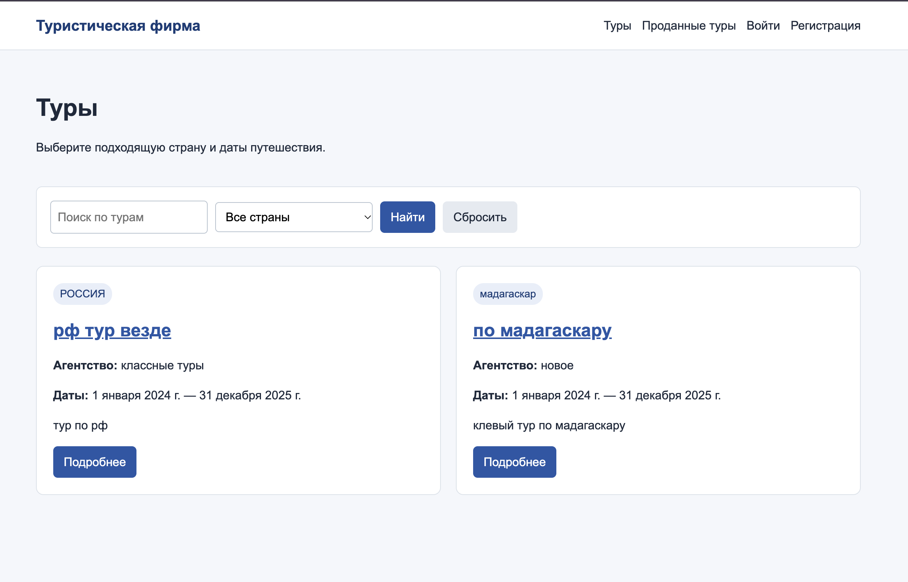

### Подтверждение бронирований

Обычный пользователь видит только свои бронирования. Сотрудник видит все бронирования и может подтвердить их в клиентском интерфейсе или через Django Admin.

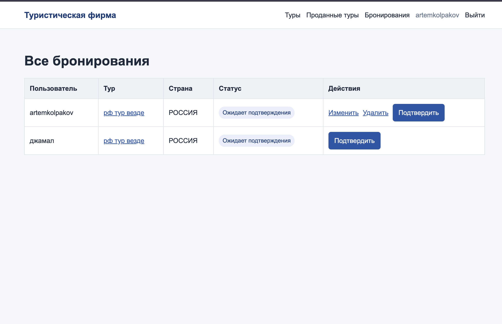

### Отзывы

Авторизованный пользователь может оставить отзыв, указав даты поездки, текст и рейтинг от 1 до 10. На странице тура отображаются автор и содержание отзыва.

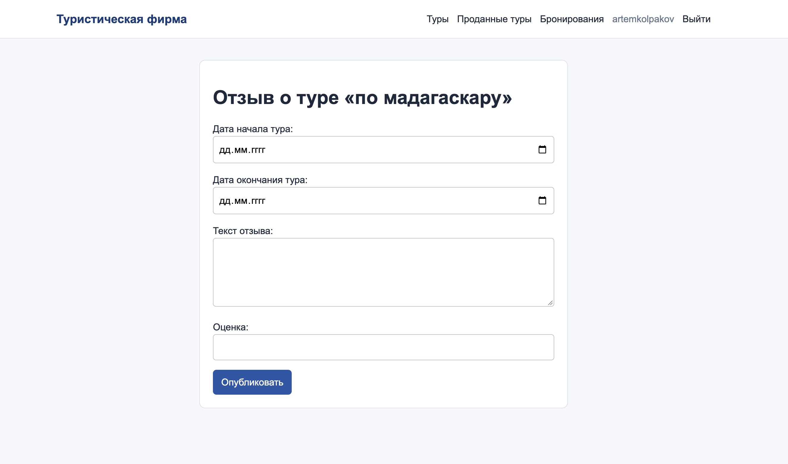

### Проданные туры

Подтверждённые бронирования выводятся в отдельной таблице.

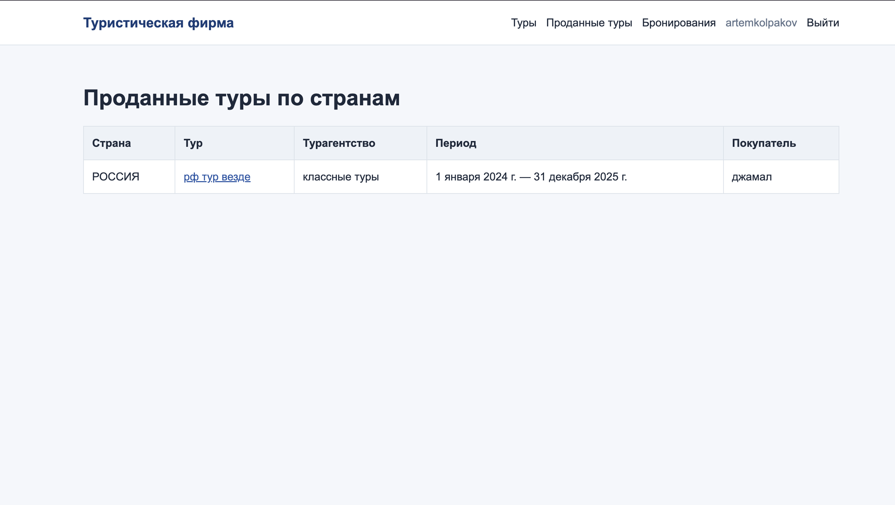

## Вывод

В ходе работы были изучены основные возможности Django. Реализованы модели данных, административная панель, регистрация пользователей, формы, бронирование туров, отзывы и разграничение прав доступа.
